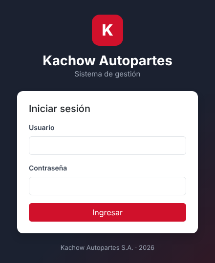
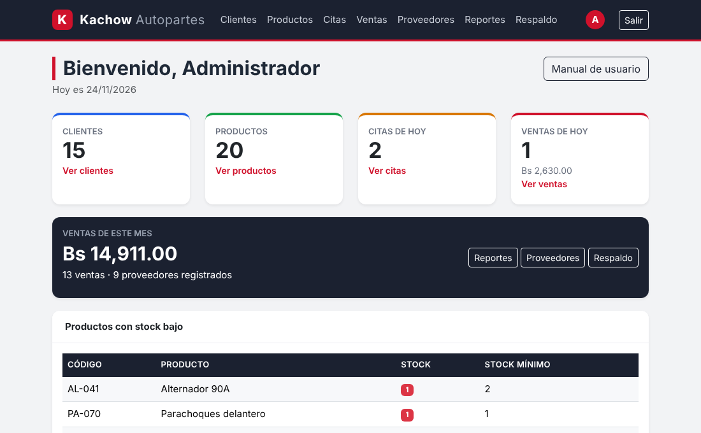
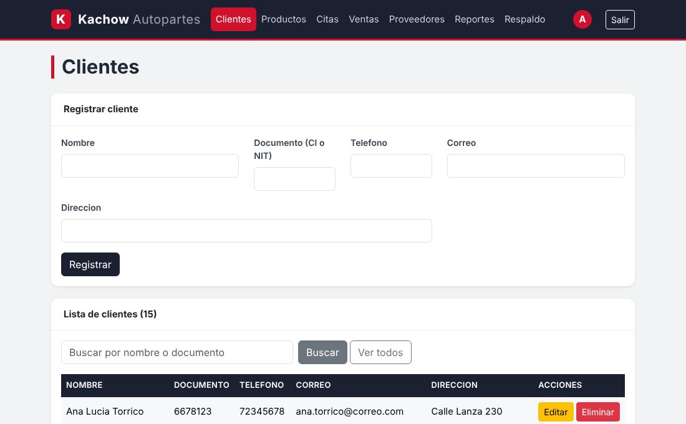
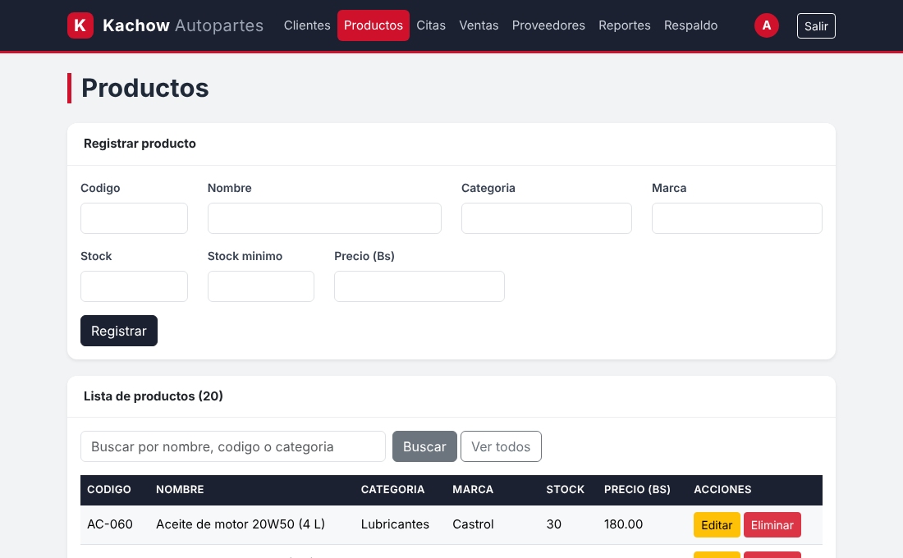
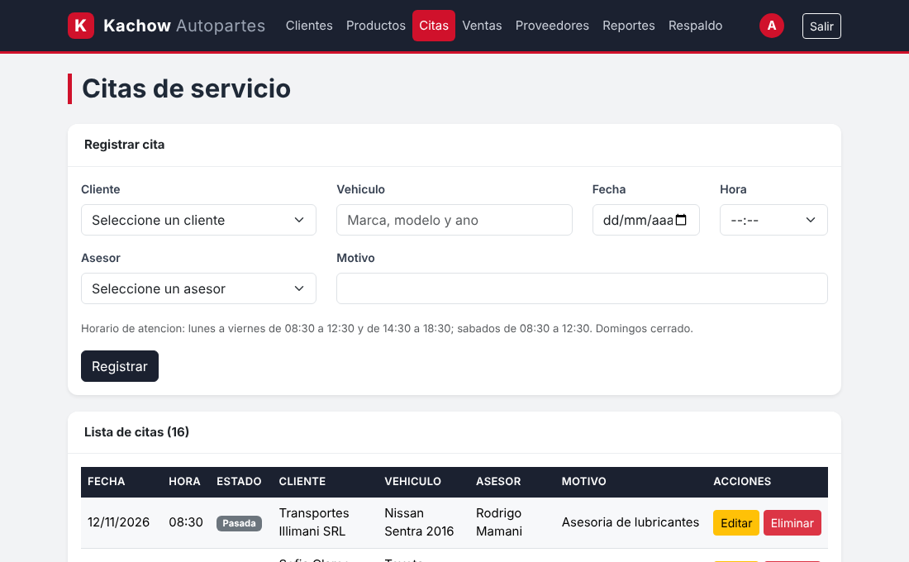
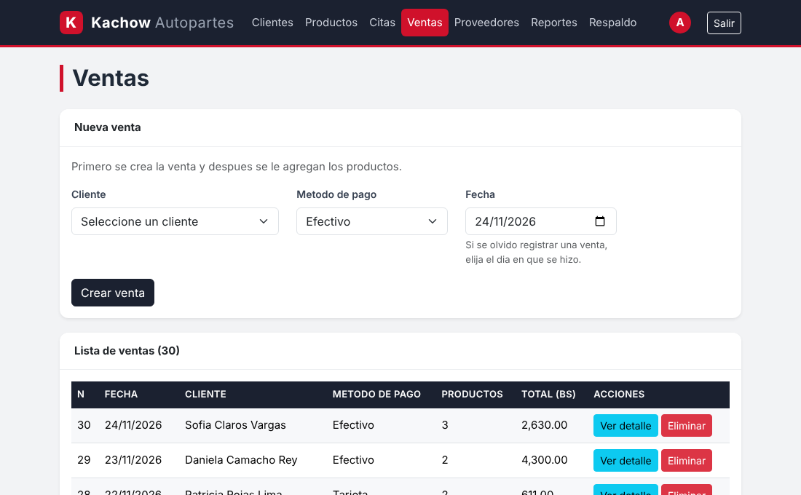
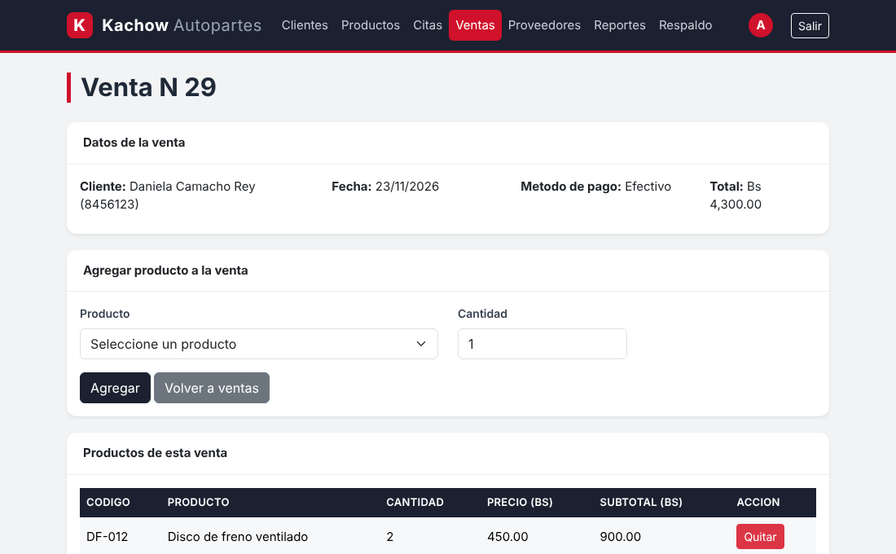
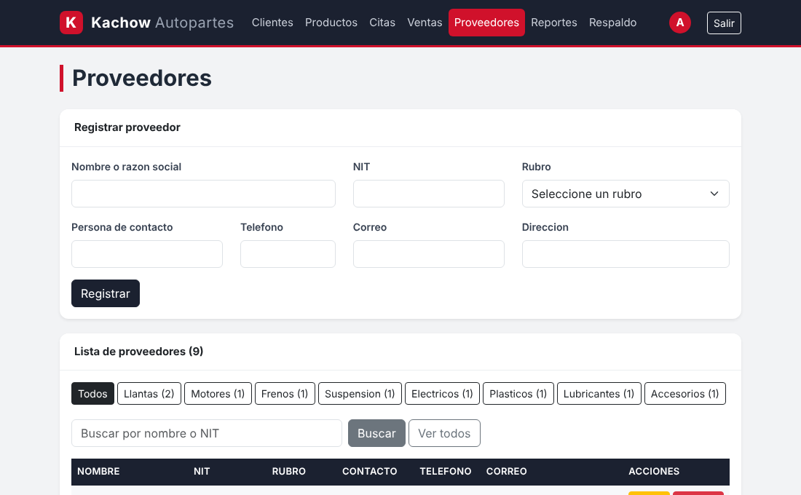
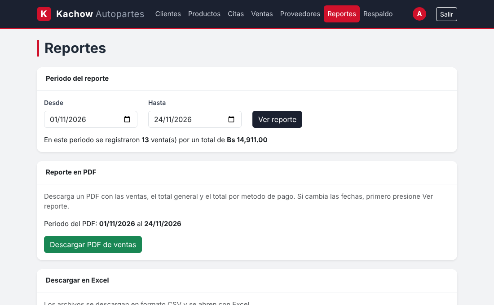
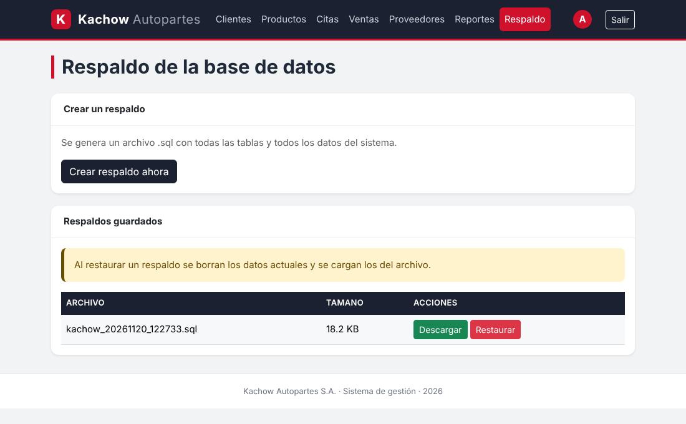

# Manual de usuario — Sistema Kachow Autopartes

Este manual explica cómo usar el sistema de gestión de Kachow Autopartes S.A. para registrar clientes, productos, proveedores, citas de asesoría y ventas, y para obtener reportes y respaldos. Las secciones marcadas como **solo administrador** no aparecen en el menú del vendedor.

## Contenido

1. [Ingresar y salir del sistema](#ingreso)
2. [Panel principal](#panel)
3. [Clientes](#clientes)
4. [Productos](#productos)
5. [Citas de asesoría](#citas)
6. [Ventas](#ventas)
7. [Proveedores](#proveedores) (solo administrador)
8. [Reportes](#reportes) (solo administrador)
9. [Respaldo de la base de datos](#respaldo) (solo administrador)
10. [Mensajes frecuentes](#mensajes)

## 1. Ingresar y salir del sistema

Abra el navegador y escriba la dirección del sistema. En la computadora donde está instalado con Laragon es **http://localhost/Kachow**. Escriba su usuario y su contraseña y presione **Ingresar**.

Si el usuario o la contraseña están mal, el sistema muestra "Usuario o contrasena incorrectos" y no deja pasar. Por seguridad no dice cuál de los dos falló.

Para salir presione **Salir**, arriba a la derecha. Cierre la sesión cada vez que deje la computadora, porque cualquiera que la use después entraría con su usuario.

Hay dos tipos de usuario. El **administrador** puede usar todo el sistema. El **vendedor** solo ve Clientes, Productos, Citas y Ventas; si intenta abrir otra sección, el sistema lo devuelve al panel con el aviso "No tiene permiso para entrar a esa seccion".

## 2. Panel principal

Es la primera pantalla después de ingresar. Las tarjetas muestran cuántos clientes y productos hay, las citas de hoy y las ventas de hoy con su importe. Cada tarjeta tiene un enlace que lleva a su módulo.

Más abajo está la lista de **productos con stock bajo**: los que tienen un stock igual o menor a su stock mínimo. Conviene revisarla cada mañana para pedir mercadería a tiempo.

El administrador ve además un recuadro oscuro con el total vendido en el mes. El botón **Manual de usuario** abre este manual.

En el celular el menú se esconde. Se abre con el botón de tres rayas que aparece arriba a la derecha.

## 3. Clientes

**Registrar un cliente.** Llene el formulario y presione **Registrar**. El nombre y el documento son obligatorios. El documento lleva solo números, entre 5 y 15, y no puede repetirse. El teléfono, si se escribe, debe tener 7 u 8 números.

**Buscar.** Escriba parte del nombre o del documento en el cuadro de búsqueda y presione **Buscar**. **Ver todos** vuelve a mostrar la lista completa.

**Editar.** Presione el botón amarillo **Editar** del cliente, corrija los datos y presione **Guardar cambios**.

**Eliminar.** Presione el botón rojo **Eliminar** y confirme. Un cliente que ya tiene citas o ventas no se puede eliminar, porque esos registros quedarían sin dueño; el sistema avisa cuántas tiene.

## 4. Productos

Se registran igual que los clientes. El código no puede repetirse y el precio debe ser mayor que cero. El **stock mínimo** es la cantidad a partir de la cual el producto se considera escaso: cuando el stock llega a ese número o baja de él, aparece en rojo en la lista y en el panel principal.

El stock baja solo cada vez que se vende el producto y vuelve a subir si se quita de una venta. Solo hace falta editarlo a mano cuando llega mercadería nueva.

Un producto que ya figura en alguna venta no se puede eliminar.

## 5. Citas de asesoría

Elija el cliente, escriba el vehículo, elija la fecha, la hora y el asesor, y presione **Registrar**. El motivo es opcional.

El **asesor** se elige de una lista con los nombres de los vendedores. La **hora** también se elige de una lista, cada 30 minutos y solo dentro del horario de atención:

- Lunes a viernes: de 08:30 a 12:30 y de 14:30 a 18:30.
- Sábados: de 08:30 a 12:30.
- Domingos: cerrado.

La última hora de cada turno es media hora antes del cierre, para que la cita termine dentro del horario. Si se elige un sábado por la tarde, un domingo, una fecha pasada o una hora que ya pasó, el sistema no guarda la cita y explica el motivo. Tampoco deja dar dos citas al mismo asesor el mismo día a la misma hora; a otro asesor sí.

En la lista, cada cita tiene una etiqueta: **Hoy** (verde), **Próxima** (azul) o **Pasada** (gris).

## 6. Ventas

Una venta se registra en dos pasos: primero se crea y después se le agregan los productos.

1. En **Ventas**, elija el cliente, el método de pago y la fecha, y presione **Crear venta**.
2. Se abre el detalle de la venta. Elija un producto, escriba la cantidad y presione **Agregar**. Repita con cada producto.
3. El total se calcula solo y el stock de cada producto baja en ese momento.

Si se pide más cantidad de la que hay en stock, el sistema avisa cuántas unidades quedan y no agrega la línea. Si se agrega un producto que ya estaba en la venta, se suma a la misma línea. El botón **Quitar** saca un producto de la venta y devuelve su cantidad al stock.

**Si se olvidó registrar una venta.** Puede registrarla después. Al crearla, en el campo **Fecha** elija el día en que realmente se hizo la venta, en lugar de la fecha de hoy. La venta queda guardada con esa fecha, aparece en la lista en el lugar que le corresponde y se cuenta en los reportes de ese día. El stock se descuenta al momento de registrarla. Lo que el sistema no acepta son fechas futuras.

**Eliminar una venta.** El botón rojo **Eliminar** de la lista borra la venta completa y devuelve al stock todos sus productos. Una venta que se creó y quedó sin productos aparece con la etiqueta amarilla "Sin productos"; se puede completar o eliminar.

## 7. Proveedores (solo administrador)

Al registrar un proveedor se elige su **rubro**, es decir, el tipo de repuesto que vende: Llantas, Motores, Frenos, Suspensión, Eléctricos, Plásticos, Lubricantes o Accesorios. El NIT lleva solo números y no puede repetirse.

Arriba de la lista hay un botón por cada rubro, con la cantidad de proveedores entre paréntesis. Al presionar uno, la lista muestra solo los proveedores de ese rubro; **Todos** quita el filtro. Dentro de un rubro también se puede buscar por nombre o por NIT.

## 8. Reportes (solo administrador)

Elija las fechas **Desde** y **Hasta** y presione **Ver reporte**. El reporte muestra las ventas del período, la cantidad de ventas, el importe total y los productos más vendidos.

Con los botones de descarga se obtiene el mismo reporte como archivo: **CSV** para abrirlo en Excel (ventas, detalle o productos más vendidos) o **PDF** para imprimirlo, con el total por método de pago.

## 9. Respaldo de la base de datos (solo administrador)

**Crear respaldo ahora** guarda una copia de todos los datos en un archivo .sql con la fecha y la hora en el nombre. Se recomienda hacerlo al final de cada día.

**Descargar** baja el archivo a la computadora. Guárdelo también en una memoria USB o en otro disco: si el disco de la computadora se daña, los respaldos guardados en ella se pierden.

**Restaurar** deja la base de datos exactamente como estaba cuando se hizo ese respaldo. Todo lo que se registró después se pierde, por eso el sistema pide confirmación.

## 10. Mensajes frecuentes

| Mensaje | Qué hacer |
|---|---|
| Ya existe un cliente con ese documento | El cliente ya está registrado. Búsquelo en la lista. |
| Solo hay N unidades en stock | Venda una cantidad menor o registre la mercadería que llegó. |
| El asesor ya tiene una cita ese dia a esa hora | Elija otra hora u otro asesor. |
| Los sabados solo se atiende de 08:30 a 12:30 | Elija una hora de la mañana o un día de lunes a viernes. |
| Los domingos no se atiende | Elija otro día. |
| La fecha de la venta no puede ser futura | Elija la fecha de hoy o el día en que se hizo la venta. |
| No se puede eliminar: el cliente tiene citas o ventas | El cliente no se puede borrar. Puede dejarlo registrado. |
| No tiene permiso para entrar a esa seccion | Esa sección es solo para el administrador. |
